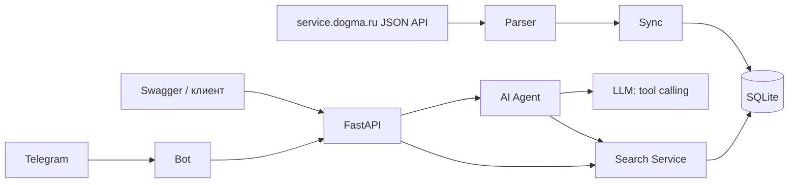

# DOGMA Apartment AI Agent

Сервис интеллектуального поиска квартир застройщика [DOGMA](https://dogma.ru/kvartiry).
Пользователь описывает квартиру на естественном русском языке («Найди студию в ЖК Самолёт
до 7 млн, от 30 м²»), AI-агент превращает запрос в проверенные фильтры, а backend ищет
**реальные** квартиры в локальной базе, ранжирует их и объясняет, почему каждая подходит.

## Оригинальное тестовое задание

Что нужно сделать:

- Спарсить данные о квартирах с сайта dogma.ru: ЖК, цена, площадь, количество комнат, этаж,
  статус, ссылка на лот.
- Сохранить данные в удобную структуру, например JSON или SQLite.
- Реализовать фильтрацию по 3 основным параметрам: бюджет, метраж, ЖК.
- Сделать агента, который принимает запрос в свободной форме, например: «Найди студию в ЖК X
  до 7 млн, от 30 м²», и возвращает подходящие варианты.

Что должно быть в результате:

- Скрипт или сервис для парсинга данных.
- Логика подбора квартир по параметрам.
- Простой AI-интерфейс: чат, Telegram-бот или API.
- Выдача топ-3/5 подходящих квартир с кратким объяснением, почему они подходят под запрос.

## Основные возможности

- **Парсер** публичного JSON API каталога dogma.ru: все города (≈15 тыс. квартир в продаже),
  пагинация, ретраи с exponential backoff, ограничение частоты и конкурентности,
  дедупликация, валидация, демо-лимиты.
- **SQLite** с идемпотентной синхронизацией (UPSERT), корректной обработкой изменения
  цены/статуса и безопасным снятием лотов только после подтверждённо полного сбора.
- **Поиск без LLM**: бюджет, площадь, ЖК, комнаты, город, этажи; три вида сортировки;
  фильтрация в SQL; детерминированные объяснения.
- **AI-агент** на Tool Calling (любой OpenAI-совместимый провайдер): LLM только разбирает
  текст, всё остальное — backend. Квартиры, цены и ссылки придумать невозможно.
- **REST API + Swagger UI** — основной интерфейс; **Telegram-бот** — опциональный тонкий
  клиент поверх API.
- Docker Compose, healthcheck, непривилегированный пользователь, постоянный volume.

## Технологический стек

Python 3.12 · FastAPI · Uvicorn · Pydantic v2 / pydantic-settings · httpx · SQLAlchemy 2
(async) + aiosqlite · OpenAI Python SDK (OpenAI-совместимый протокол) · aiogram 3 ·
pytest / pytest-asyncio / pytest-cov · Ruff · mypy (strict) · uv · Docker Compose.

## Архитектура



Подробно — [docs/ARCHITECTURE.md](docs/ARCHITECTURE.md), решения —
[docs/DECISIONS.md](docs/DECISIONS.md), исследование источника —
[docs/SOURCE_RESEARCH.md](docs/SOURCE_RESEARCH.md).

## Быстрый старт (Docker)

Требуется Docker с Compose v2.24+.

```bash
cp .env.example .env          # для AI-чата заполните LLM_* (см. ниже); без них работает остальное
docker compose up --build -d  # API на http://localhost:8000, Swagger: http://localhost:8000/docs
docker compose run --rm api python -m app.cli sync   # сбор реальных данных (~1–2 минуты)
```

Быстрый демо-сбор (по 2 страницы на город):

```bash
docker compose run --rm api python -m app.cli sync --max-pages 2
```

База хранится в volume `apartments-data` и переживает перезапуск и пересоздание
контейнеров (`docker compose down && docker compose up -d`). Удалить данные:
`docker compose down -v`.

Telegram-бот (нужен `TELEGRAM_BOT_TOKEN` в `.env`):

```bash
docker compose --profile bot up -d
```

## Локальный запуск без Docker

```bash
uv sync                                  # Python 3.12 + зависимости из uv.lock
cp .env.example .env
uv run python -m app.cli sync            # наполнить data/apartments.db
uv run uvicorn app.main:app --reload     # http://localhost:8000/docs
uv run python -m app.bot                 # опционально, Telegram-бот
```

## Настройка LLM-провайдера

Агент работает с любым endpoint, поддерживающим OpenAI Chat Completions с tool calling.

| Переменная | Назначение |
|---|---|
| `LLM_MODEL` | имя модели (обязательно) |
| `LLM_API_KEY` | ключ (можно не задавать для локального Ollama/vLLM) |
| `LLM_BASE_URL` | пусто — OpenAI; иначе URL совместимого API |
| `LLM_TIMEOUT` | таймаут запроса, с (30) |
| `LLM_MAX_RETRIES` | повторы при таймаутах/429/5xx (2) |

Примеры: OpenAI (`LLM_MODEL=gpt-4o-mini`), OpenRouter
(`LLM_BASE_URL=https://openrouter.ai/api/v1`), DeepSeek (`LLM_BASE_URL=https://api.deepseek.com`,
`LLM_MODEL=deepseek-chat`), локальный Ollama
(`LLM_BASE_URL=http://host.docker.internal:11434/v1`, `LLM_MODEL=qwen2.5:7b`).

Без настроенной модели `POST /api/v1/chat` отвечает `503 llm_not_configured`, а парсинг,
структурированный поиск и справочник ЖК работают.

## Парсер

```bash
python -m app.cli sync [--city 3 --city "Омск"] [--max-pages N] [--max-lots N] [--page-size N]
python -m app.cli stats     # статистика БД и последней синхронизации (JSON)
python -m app.cli init-db   # только создать таблицы
```

- Источник: `POST https://service.dogma.ru/api/layouts-filter/v4/objects/filter` — тот же
  API, что использует страница каталога (см. [SOURCE_RESEARCH.md](docs/SOURCE_RESEARCH.md)).
- Города: `PARSER_CITY_IDS=1,2,3,4,5,6,7` (Новороссийск, Реутов, Краснодар, Пушкино, Калуга,
  Омск, Ленинградская обл.).
- Коды выхода: `0` — полный успешный сбор, `2` — частичный (демо-лимит или ошибки части
  страниц; данные сохранены, лоты не снимались с продажи), `1` — неуспех (БД не изменена).
- Повторный запуск не создаёт дублей: обновляются цены/статусы, `updated_at` меняется только
  при реальном изменении.

## Примеры API-запросов

Структурированный поиск (без LLM):

```bash
curl -s -X POST http://localhost:8000/api/v1/apartments/search \
  -H 'Content-Type: application/json' \
  -d '{"max_price": 7000000, "min_area": 30, "complex_name": "Самолёт", "rooms": 0, "limit": 5}'
```

AI-чат:

```bash
curl -s -X POST http://localhost:8000/api/v1/chat \
  -H 'Content-Type: application/json' \
  -d '{"message": "Найди студию в ЖК Самолёт до 7 млн, от 30 квадратов"}'
```

Ответ чата содержит: `query`, `status` (`ok`, `no_results`, `clarification_needed`,
`contradiction`, `off_topic`), `message`, `filters` (распознанные параметры), `total_found`,
`items` (квартиры с `complex_name`, `price`, `area`, `rooms`, `floor`, `status`, `url`,
`explanation`…), `candidates`, `data_freshness`.

Остальные эндпоинты: `GET /health`, `GET /ready`, `GET /api/v1/complexes`, Swagger — `/docs`.

Формат ошибок единый:

```json
{"error": {"code": "filter_value_not_resolved", "message": "ЖК «Парк» не найден однозначно…",
           "details": {"field": "complex_name", "candidates": ["DОГМА ПАРК", "Парк Победы"]}}}
```

## Примеры реальных результатов

См. раздел «Проверка на реальных данных» ниже — туда внесены только фактически полученные
результаты.

## Ранжирование

Ранжирование детерминированное и выполняется в SQL, LLM в нём не участвует:

| `sort_by` | Порядок |
|---|---|
| `price_asc` (по умолчанию) | цена ↑, при равной цене площадь ↓, затем id ↑ |
| `area_desc` | площадь ↓, затем цена ↑, id ↑ |
| `price_per_sqm_asc` | цена за м² ↑, затем цена ↑, id ↑ |

Все фильтры объединяются по AND, границы включительные, выдаются только лоты в статусе
`available`. Условия никогда не ослабляются автоматически: если ничего не найдено,
сервис говорит, какие параметры можно изменить. По умолчанию возвращается топ-5,
максимум 10. Объяснения строятся Python-кодом из тех же чисел, что в JSON
(«стоит 6 450 000 ₽ — на 550 000 ₽ меньше максимального бюджета, площадь 32,5 м² — на 2,5 м²
больше минимальной»).

## Тесты и качество

```bash
uv run ruff check .
uv run ruff format --check .
uv run mypy app
uv run pytest -v
uv run pytest --cov=app --cov-report=term-missing
```

Автоматические тесты не ходят в сеть: источник подменяется `httpx.MockTransport`,
LLM — скриптовым провайдером и mock-транспортом OpenAI SDK. Они не подтверждают работу
внешних интеграций — для этого выполнялась отдельная ручная проверка (см. ниже).
CI (`.github/workflows/ci.yml`) запускает линтеры, mypy, тесты с порогом покрытия 80% и
сборку Docker-образа.

## Ограничения

- Источник — недокументированный API сайта. При изменении формата синхронизация
  завершится ошибкой формата, ранее сохранённые данные останутся нетронутыми.
- Список `city_id` задан в конфигурации: API не предоставляет перечня городов
  (новый город нужно добавить в `PARSER_CITY_IDS`).
- В API нет общей этажности дома, поэтому `total_floors` не хранится; `completion_date`
  берётся из поля `construction_deadline` (срок сдачи дома по данным источника).
- Сайт отдаёт в каталог только лоты «В продаже», поэтому других статусов источника нет:
  `unavailable` означает «лот пропал из каталога при полной синхронизации».
- Качество понимания текста зависит от выбранной модели; корректность данных гарантирует
  backend.
- Без Alembic: схема создаётся `create_all` (ADR-010).
- Разработка велась в песочнице без доступа к dogma.ru и Docker Hub; реальные
  интеграции проверялись отдельно (см. ниже).

## Возможные направления развития

- Alembic-миграции, история цен (таблица изменений).
- Периодическая синхронизация (cron / systemd timer / отдельный сервис Compose).
- Диалоговый контекст в чате (уточнения без повторения всех условий).
- Дополнительные фильтры источника: отделка, срок сдачи, вид из окна, класс жилья.
- PostgreSQL при необходимости нескольких экземпляров API.
