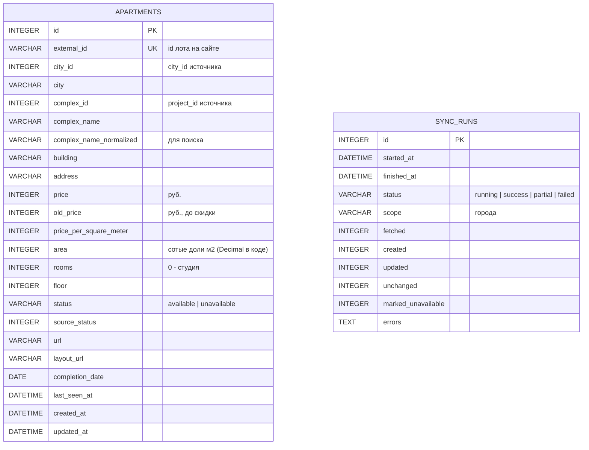
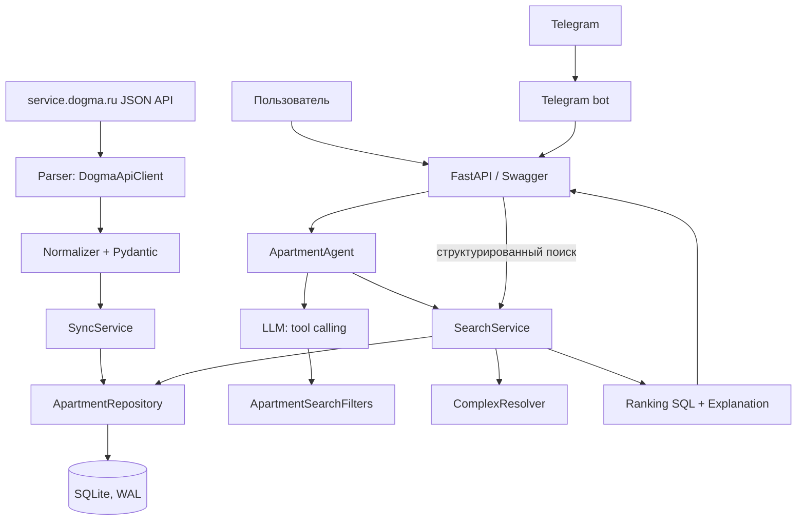
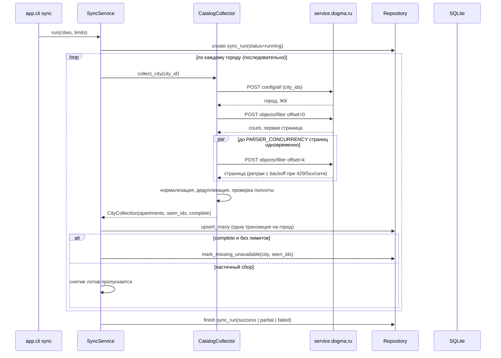
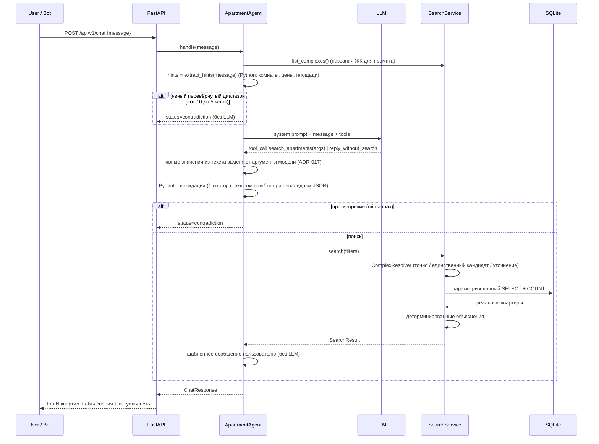

# Архитектура DOGMA Apartment AI Agent

## 1. Описание системы

Сервис интеллектуального поиска квартир застройщика DOGMA. Состоит из двух независимо
запускаемых процессов поверх одной SQLite-базы и одного опционального клиента:

1. **Синхронизация** (`python -m app.cli sync`) — забирает лоты из публичного JSON API
   сайта, нормализует и транзакционно сохраняет их в SQLite.
2. **API** (FastAPI + Uvicorn) — структурированный поиск, AI-чат, справочник ЖК,
   health/readiness. Swagger UI — основной пользовательский интерфейс.
3. **Telegram-бот** (`python -m app.bot`, опционально) — тонкий клиент к `POST /api/v1/chat`.

Это модульный монолит: один пакет `app`, модули с явными границами, без брокеров и
внешних сервисов, кроме LLM-провайдера.

## 2. Компоненты и границы ответственности

| Компонент | Модули | Отвечает за | Не делает |
|---|---|---|---|
| Configuration | `app/config.py` | Настройки из env, валидация | — |
| Parser | `app/parser/*` | HTTP к источнику, ретраи, пагинация, нормализация | Не пишет в БД, не знает про поиск |
| Sync | `app/services/sync.py` | Оркестрация: парсер → репозиторий, решение о снятии лотов | Не ходит в сеть напрямую |
| Repository | `app/db/*` | SQLAlchemy-модели, UPSERT, параметризованный поиск | Не валидирует пользовательский ввод |
| Search Service | `app/services/search.py`, `complexes.py`, `explanation.py` | Разрешение ЖК, фильтры, ранжирование, объяснения | Не зависит от LLM |
| AI Agent | `app/agent/*` | Интерпретация текста через Tool Calling, сверка явных чисел из текста (`hints.py`), валидация аргументов | Не обращается к БД, не формирует SQL, не пишет текст о квартирах |
| API | `app/api/*`, `app/main.py`, `app/dependencies.py` | HTTP-контракт, DI, единый формат ошибок | Не содержит бизнес-логики |
| Telegram bot | `app/bot/*` | Приём сообщений и форматирование ответа API | Не обращается к БД и LLM |

## 3. Структура проекта

```text
app/
├── main.py            # create_app(), lifespan, обработчики ошибок
├── config.py          # Settings (pydantic-settings)
├── logging_config.py  # JSON-логирование
├── cli.py             # sync / init-db / stats
├── dependencies.py    # DI для FastAPI
├── exceptions.py      # иерархия доменных ошибок
├── api/               # health.py, apartments.py, chat.py, router.py
├── parser/            # client.py, schemas.py, normalizer.py, service.py
├── db/                # models.py, session.py, repository.py, types.py
├── schemas/           # apartment.py, search.py, chat.py
├── services/          # search.py, complexes.py, explanation.py, sync.py, text.py
├── agent/             # service.py, provider.py, prompts.py, tools.py, hints.py
└── bot/               # main.py, api_client.py, formatting.py
tests/
├── fixtures/          # ответы API в формате источника
├── unit/  integration/
docs/  .github/workflows/ci.yml  Dockerfile  docker-compose.yml
```

## 4. Схема базы данных



Таблицы не связаны внешним ключом: `sync_runs` — журнал запусков, источник
«актуальности данных» для ответов API.

### 4.1. Обоснование схемы

- **`external_id` UNIQUE.** Идентификаторы лотов в API глобальные (одна последовательность
  на все города), поэтому составной ключ не нужен. UNIQUE — опора для `ON CONFLICT` UPSERT.
- **Цена — `INTEGER` в рублях.** Деньги без плавающей точки.
- **Площадь — `INTEGER` в сотых долях м²** через `TypeDecorator` (`app/db/types.py`):
  в Python это `Decimal('32.30')`, в SQLite — `3230`. SQLite не имеет настоящего
  DECIMAL и хранит `NUMERIC` как REAL, что дало бы неконтролируемое округление и
  неточные сравнения на границах (`area >= 30`). Сравнение целых точное.
- **`complex_name_normalized`** — `casefold`, `ё→е`, без префиксов «ЖК»/«МКР», кавычек
  и лишних пробелов. Индексируемое равенство вместо `LIKE`/`lower()` на лету
  (`lower()` в SQLite не работает с кириллицей).
- **`price_per_square_meter`** хранится, а не считается в `ORDER BY`: сортировка
  индексируема и совпадает с тем, что видит пользователь.
- **`status` + `last_seen_at`** — мягкое снятие с продажи вместо удаления: история
  сохраняется, а пользовательская выдача фильтрует `status = 'available'`.

### 4.2. Индексы

| Индекс | Зачем |
|---|---|
| `uq_apartments_external_id` | UPSERT и защита от дублей |
| `ix_apartments_search (status, complex_name_normalized, rooms, price)` | Основной сценарий «ЖК + комнаты + бюджет», сортировка по цене |
| `ix_apartments_status_price (status, price)` | Поиск без ЖК, сортировка по умолчанию |
| `ix_apartments_status_area (status, area)` | Фильтр/сортировка по площади |
| `ix_apartments_status_ppsm (status, price_per_square_meter)` | Сортировка по цене м² |
| `ix_apartments_city_status (city_id, status)` | Снятие лотов после синхронизации города, фильтр по городу |

Для ~15 тыс. строк любой запрос выполняется за миллисекунды и без индексов, но индексы
отражают реальные шаблоны доступа и дешевы.

## 5. Взаимодействие компонентов



## 6. Sequence: синхронизация



## 7. Sequence: AI-запрос



LLM участвует только в одном шаге — превращении текста в аргументы инструмента. Числа,
явно названные в тексте, Python сверяет и при расхождении исправляет сам. Все цены, ссылки и
тексты о квартирах формирует backend из данных БД.

## 8. Жизненный цикл синхронизации данных

1. Создаётся запись `sync_runs(status=running)`.
2. Для каждого города: справочник → первая страница → остальные страницы параллельно
   (ограниченно) → нормализация. Невалидный объект пропускается с логом, но его `id`
   считается «увиденным».
3. **UPSERT** города в одной транзакции (`INSERT … ON CONFLICT(external_id) DO UPDATE`):
   обновляются цена, статус (`available`), площадь и т. д., `last_seen_at`;
   `updated_at` меняется только если данные действительно изменились.
4. **Снятие с продажи** выполняется, только если сбор города подтверждённо полный:
   нет упавших страниц, не задан `--max-pages/--max-lots`, число уникальных id ≥ `count`.
   Тогда лоты города, которых нет среди увиденных id, получают `status = unavailable`.
   Лот, вернувшийся в каталог, снова становится `available` при следующем UPSERT.
5. При сетевой ошибке, ошибке формата или неполном сборе ранее сохранённые данные не
   удаляются и не помечаются недоступными.
6. Итог: `success` (все города полные), `partial` (часть данных сохранена), `failed`
   (ничего не сохранено). Код выхода CLI: `0` / `2` / `1`.

## 9. Конкурентность

- **Парсер:** `asyncio` + `httpx.AsyncClient`. Страницы города запрашиваются через
  `asyncio.Semaphore(PARSER_CONCURRENCY)` (по умолчанию 3) и общий ограничитель частоты
  (`PARSER_REQUEST_DELAY` между стартами запросов). Города обрабатываются
  последовательно. Неограниченного числа одновременных запросов нет.
- **SQLite:** WAL, `busy_timeout=5000`, `foreign_keys=ON`. Писатель один — процесс
  синхронизации, транзакции короткие (один город, пакеты по 500 строк). API только читает,
  поэтому читатели не блокируются записью в режиме WAL.
- **API:** асинхронные эндпоинты; сетевой ввод-вывод (LLM) — асинхронный клиент,
  блокирующих HTTP-вызовов внутри эндпоинтов нет. Сессия БД — на запрос.
- **LLM:** не более `1 + LLM_MAX_RETRIES` попыток на транзиентные ошибки и не более одной
  «ремонтной» попытки при невалидных аргументах инструмента.

## 10. Обработка ошибок

| Ситуация | Поведение |
|---|---|
| Таймаут/сеть/5xx источника | до `PARSER_MAX_RETRIES` повторов с backoff `0.5·2^n` + jitter |
| 429 от источника | пауза для **всех** воркеров (`Retry-After` или 5→10→20→40→60 с), интервал между запросами удваивается до 5 с до конца запуска |
| 4xx источника, невалидный JSON/формат | страница помечается ошибкой без повторов, сбор города неполный |
| Невалидный объект | пропуск + warning с `external_id` и причиной |
| LLM не настроен | `503 llm_not_configured`, упрощённого режима нет (ADR-018) |
| LLM недоступен / таймаут / rate limit | ретраи, затем `503 llm_unavailable` / `503 llm_rate_limited` |
| Невалидный ответ модели | 1 повтор с текстом ошибки, затем `502 llm_invalid_response` |
| Неоднозначный / несуществующий ЖК | `200` со `status=clarification_needed` (чат) / `422 filter_value_not_resolved` (поиск); `details.reason` = `ambiguous` или `not_found` |
| Ошибка валидации запроса | `422 validation_error` с перечнем полей |
| Непредвиденное исключение | `500 internal_error` без деталей, детали — в лог |

Единый формат ошибки: `{"error": {"code": "...", "message": "...", "details": ...}}`.

## 11. Особенности обновления данных

- Синхронизация запускается отдельно (CLI/Docker), никогда — на пользовательский запрос.
- Повторный запуск идемпотентен: дублей нет благодаря UNIQUE + UPSERT.
- Изменение цены/статуса фиксируется в той же строке, `updated_at` отражает изменение.
- Ответы API содержат `data_freshness`: время последней успешной синхронизации, её
  статус и число доступных лотов.

## 12. Ограничения архитектуры

- Один писатель SQLite: одновременный запуск двух синхронизаций сериализуется
  `busy_timeout`; горизонтальное масштабирование API потребует общей БД.
- Список `city_id` задаётся конфигурацией (API не предоставляет список городов).
- Без истории цен — хранится текущее состояние и время изменения.
- Схема создаётся через `metadata.create_all` без миграций (см. ADR-010).
- Качество разбора текста зависит от выбранной LLM; детерминированный backend
  гарантирует корректность данных, но не понимание запроса.
